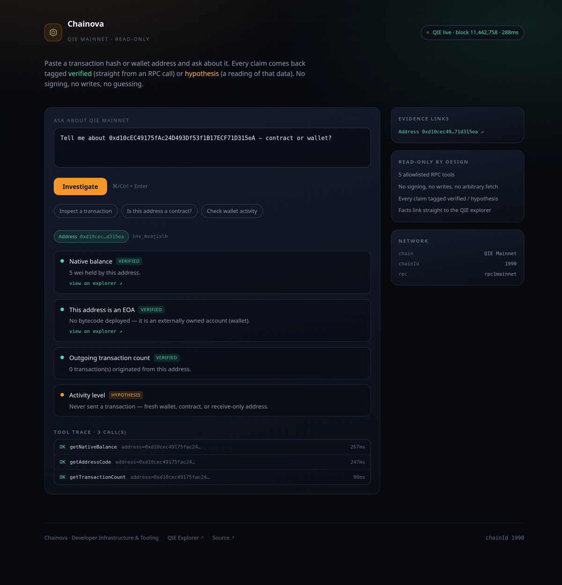

# Chainova

**AI developer copilot for the QIE Blockchain.** Ask a question in plain English about
QIE mainnet — get an answer where every statement is either *verified* from a live RPC
call or explicitly labeled a *hypothesis*.

Built for **QIE Mainnet Hackathon 3.0** — Developer Infrastructure & Tooling track.



## Why it exists

Block explorers show you raw fields. LLM chatbots guess at chain state and hallucinate
hashes. Chainova sits between them: it runs a small, allowlisted set of read-only RPC
tools against QIE mainnet and then explains **only what those tools returned**, with
a link to the explorer for every fact.

- Every fact is tagged `verified` and links to `mainnet.qie.digital`
- Every reading of that data is tagged `hypothesis`
- The full tool trace (name, args, latency, status) is visible per answer
- No signing. No writes. No arbitrary network fetch. Five tools, nothing else.

## The five tools

| Tool | Purpose |
|---|---|
| `getTransaction` | Fetch a tx by hash (null when pending/unknown) |
| `getTransactionReceipt` | Status, gas used, logs |
| `getNativeBalance` | QIE balance in wei |
| `getAddressCode` | Deployed bytecode → contract or EOA |
| `getTransactionCount` | Account nonce → activity level |

The registry is a plain object in `src/tools/registry.ts`. There is no dynamic code
path and no tool the agent can invent at runtime.

## Stack

- **Next.js 15** (App Router) + React 19 + TypeScript
- **Tailwind CSS** — dark console aesthetic
- **viem** — QIE mainnet, chainId `1990`, `rpc1mainnet` with `rpc2mainnet` fallback
- **Vitest** — integration tests that hit the real chain

No database, no auth, no background workers. One deployable service.

## Run locally

```bash
npm install
npm run dev      # http://localhost:3000
```

## Verify against the live chain

```bash
npm run verify:live   # exercises every tool, prints real mainnet output
npm test              # integration tests against QIE mainnet
```

Both scripts hit the real network. A failing test there means the chain or RPC
changed — not that a mock drifted.

## API

`POST /api/investigate`

```json
{ "question": "explain 0xc8f3…8a8d" }
```

Returns an `Investigation`: `subject`, `findings[]`, `toolTrace[]`, `explorerLinks[]`,
and the raw RPC payloads.

`GET /api/health` — chain id, latest block, RPC latency. Used by the status pill and
suitable for an uptime monitor.

## Design decisions

**Read-only is a feature, not a limitation.** A tool that can move funds has to be
audited like a wallet. A tool that can only read has a five-function attack surface,
which is why the allowlist is a literal object and not a plugin system.

**Grounded or silent.** If the prompt contains no transaction hash and no address,
Chainova says so and lists what it *can* do. It does not free-associate about the chain.

**Facts and interpretations are separated in the data model**, not just in prose —
`Finding.kind` is `verified | hypothesis | warning`, and the UI colors them differently
so a reader can see at a glance which half of the answer came from the node.

## License

MIT
